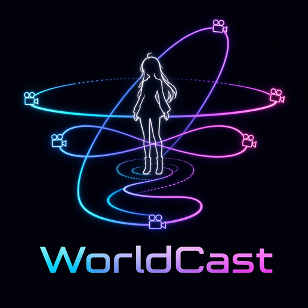

<div align="center">



# WorldCast: World-Consistent Character Video Generation with Large-Angle Camera Control

<a href="https://arxiv.org/abs/2610.33135"></a>
&ensp;
<a href="https://pixctrol.github.io/WorldCast/"></a>
&ensp;
<a href="https://github.com/PixCtrol/WorldCast"></a>
&ensp;
<a href="https://huggingface.co/ly56/worldcast/"></a>
&ensp;
<a href="#"></a>

**Lei Cao**<sup>1,2\*</sup> · **Yu Liu**<sup>2\*</sup> · **Wenhua Liao**<sup>2</sup> · **Peng Zhang**<sup>2‡</sup> · **Fei Wang**<sup>2</sup> · **Hao Zhang**<sup>1</sup> · **Jiajun Le**<sup>1</sup> · **Daiguo Zhou**<sup>2†</sup> · **Jian Luan**<sup>2</sup> · **Jiayi Ma**<sup>1,3†</sup>

<sup>1</sup>Electronic Information School, Wuhan University &ensp; <sup>2</sup>MiLM Plus, Xiaomi Inc. &ensp; <sup>3</sup>School of Robotics, Wuhan University

<sup>\*</sup>Equal Contribution &ensp; <sup>‡</sup>Project Lead &ensp; <sup>†</sup>Co-corresponding Authors

</div>

Given one reference image, a target camera trajectory, and **1–4 viewpoint
anchor images** of the subject (from arbitrary viewpoints), WorldCast
generates a video that follows the target camera motion while preserving the
subject's identity across viewpoints.

## News

- **[2026.10.23]** Initial release: inference code, bundled demo case, and project page.
- **[2026.10.28]** Model checkpoints released on [HuggingFace](https://huggingface.co/ly56/worldcast/).

## TODO

- [x] Release inference code and demo
- [x] Release paper (arXiv)
- [x] Release model checkpoints
- [ ] Release CLACT dataset
- [ ] Release training code

## Getting Started

### 1. Clone the Repository

```bash
git clone https://github.com/PixCtrol/WorldCast
cd WorldCast
```

### 2. Set Up the Environment

Python >= 3.10, a CUDA GPU (>= 48 GB recommended for the 14B model at
480x832; memory scales with resolution and frame count), bf16.

```bash
pip install -r requirements.txt
```

### 3. Download Weights

> [!IMPORTANT]
> **Model weights are now available on HuggingFace:
> [`ly56/worldcast`](https://huggingface.co/ly56/worldcast/)** — trained
> modules only, ~2 GB.

| Component | Source | Place at |
|---|---|---|
| Wan2.1-I2V-14B-720P base (VAE / text-image encoders) | HuggingFace [`Wan-AI/Wan2.1-I2V-14B-720P`](https://huggingface.co/Wan-AI/Wan2.1-I2V-14B-720P) | `pretrained/Wan2.1-I2V-14B-720P/` |
| **WorldCast trained modules (~2 GB)** | **HuggingFace [`ly56/worldcast`](https://huggingface.co/ly56/worldcast/)** | `checkpoints/` |

```bash
huggingface-cli download ly56/worldcast --local-dir checkpoints
```

- **`checkpoints/worldcast_bank.safetensors`** — the trained modules
  (`source_self_attn_bank.*` + `anchor_channel_adapter.*`), bank-only: the
  base DiT weights are **not** inside.
- **`checkpoints/base_dit.safetensors`** — the frozen base the bank was trained
  against (DiT-compatible weights + `camera_proj` + I2V channel adapter);
  **the two checkpoints must come from the same release**.

> [!NOTE]
> **A version trained on a more diverse set of camera trajectories, with
> improved trajectory stability and a wider range of camera motions, is
> currently undergoing internal review and not yet available for public
> release.** We will provide updates as soon as further information is
> available.

### 4. Run Demos

Bundled five-trajectory demo (preprocessed case included):

```bash
python demo.py \
  --manifest demo_case_traj5.json \
  --model_root pretrained/Wan2.1-I2V-14B-720P \
  --ckpt checkpoints/worldcast_bank.safetensors \
  --init_dit_from checkpoints/base_dit.safetensors
```

## Trajectories

`--traj` presets (built by `scripts/data/trajectories.py`):

| Trajectory | Motion |
|---|---|
| `orbit_360` | horizontal 360° ring about the subject |
| `lemniscate` | Gerono figure-8 in the first-frame screen plane |
| `orbit_tilt_20` | 360° ring pivoted to a 20° tilt |
| `orbit_180_push` | 180° arc with a sinusoidal push-pull radius ripple |
| `zoom_out` | one-way dolly out from the subject |
| `turn_left` / `turn_right` | one-way truck left / right (0.5× subject distance) |
| `zoom_in` | one-way dolly in, to 0.6× the subject distance |

The orbit family is degree-parameterized: `orbit_<N>[_cw|_ccw]` builds a
horizontal arc of N degrees (1–360), clockwise or counterclockwise viewed
from above; without a suffix the arc continues the base trajectory's own
direction. `orbit_360` is the closed-ring preset itself.

For batch inference over custom cases, see `scripts/infer/infer_worldcast.py`
and `launch/infer/run_anchor_inference_example.sh`; the manifest format is
shown in `examples/anchor_case_manifest.example.json`, and the bundled
`demo_case/` illustrates the full case layout.

## Citation

If WorldCast is useful for your research, please cite our paper:

```bibtex
@misc{worldcast,
  title         = {WorldCast: World-Consistent Character Video Generation with Large-Angle Camera Control},
  author        = {Cao, Lei and Liu, Yu and Liao, Wenhua and Zhang, Peng and Wang, Fei and Zhang, Hao and Le, Jiajun and Zhou, Daiguo and Luan, Jian and Ma, Jiayi},
  year          = {2026},
  eprint        = {2610.33135},
  archivePrefix = {arXiv},
  primaryClass  = {cs.CV},
  url           = {https://arxiv.org/abs/2610.33135}
}
```

## Contact

For questions, discussions, or collaborations, feel free to reach out to
**Yu Liu** at **liuyu61@xiaomi.com**, or open an issue in this repository.

## License

Apache-2.0 (inherited from DiffSynth-Studio). Wan base weights follow their
own license from Wan-AI.

## Acknowledgements

WorldCast is built on
[DiffSynth-Studio](https://github.com/modelscope/DiffSynth-Studio).

### Dataset acknowledgment

This work uses **SpatialVID** under **CC BY-NC-SA 4.0** and its Terms of Use.
The authors confirm that all uses of this dataset are strictly for academic
research purposes and not for any commercial applications.
